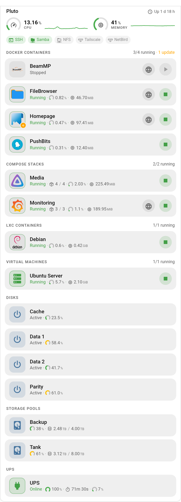
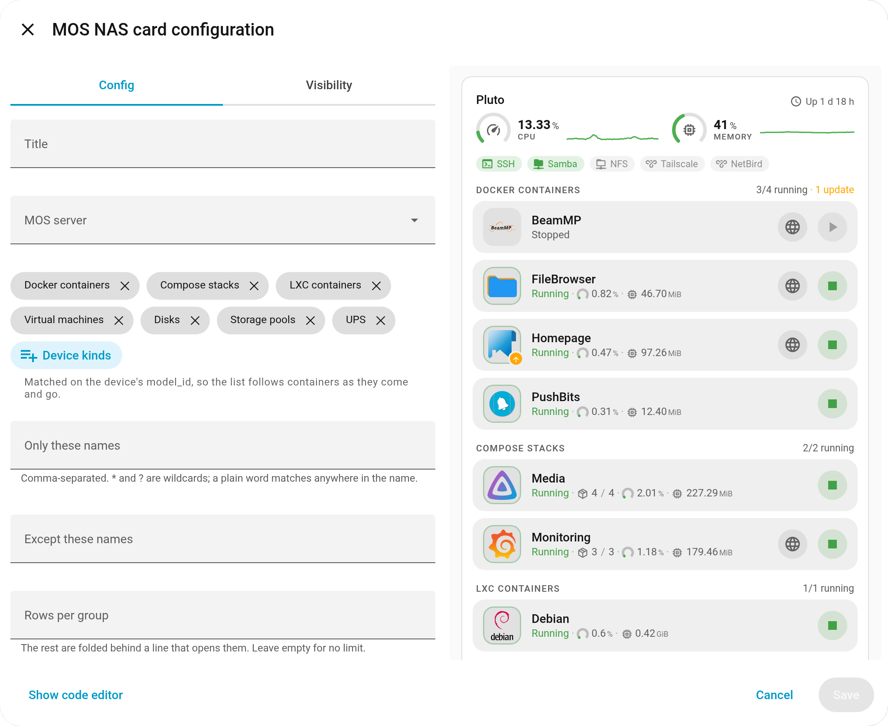
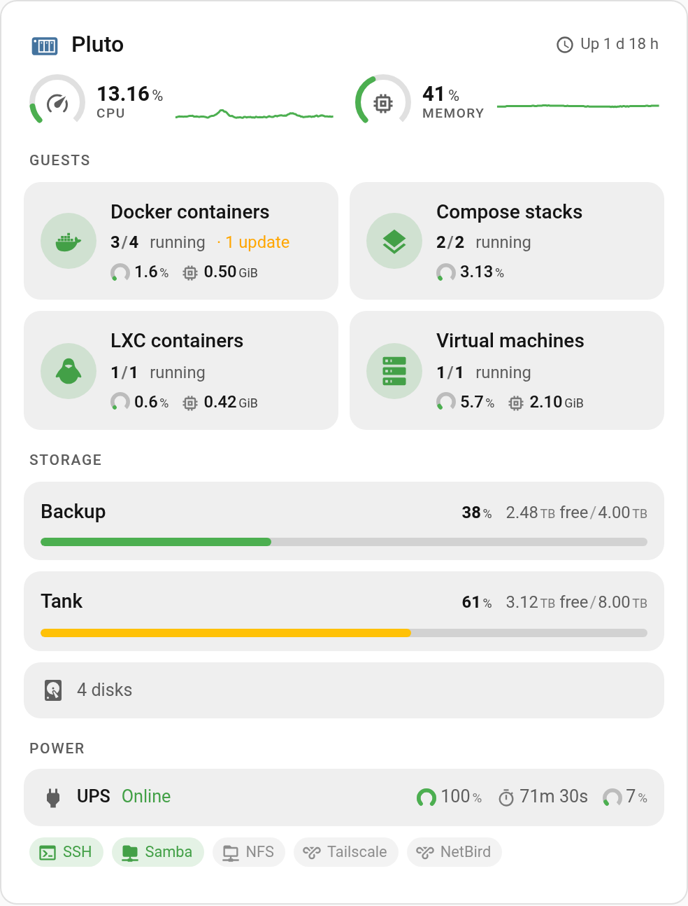
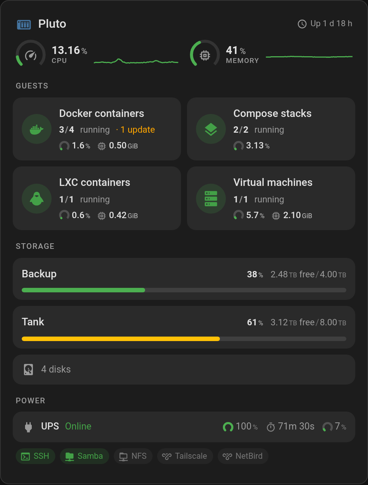
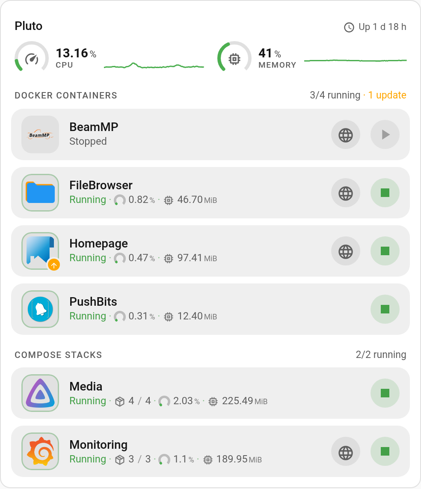
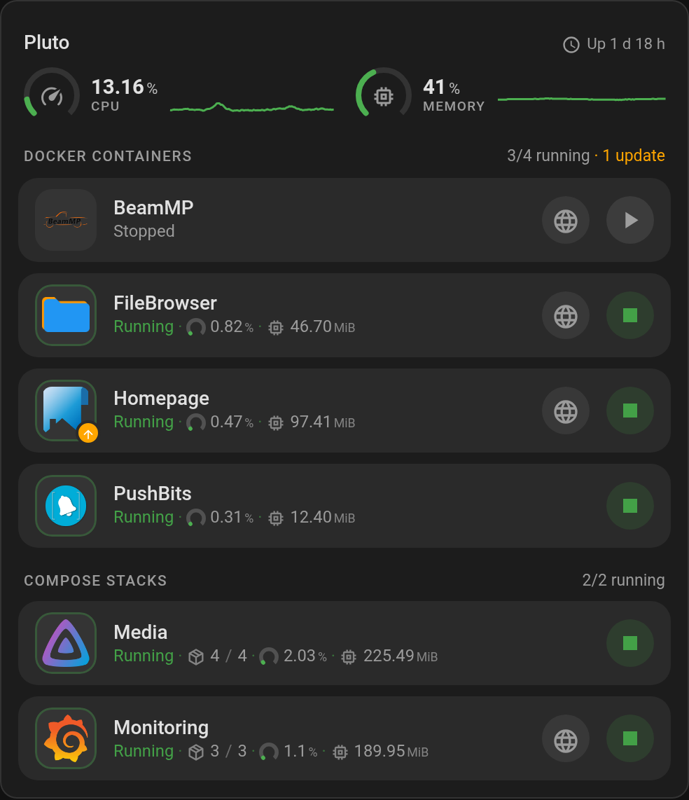

# MOS NAS Card

A Lovelace card for the [MOS NAS integration](https://github.com/anym001/ha-mos) (domain `mos`).
It lists the containers, Compose stacks, virtual machines, disks, storage pools and UPS of a MOS
server as rows and follows them as they come and go.



---

## Features

- **Seven device kinds**, each switchable on or off: Docker containers, Docker Compose stacks, LXC
  containers, virtual machines, disks, storage pools and the UPS.
- **Every row** carries the icon, the name, the state, a link to the device's own web interface and
  a start/stop button for the guests that can be controlled. A fault or a waiting update adds a
  badge on the icon.
- **Load at a glance.** The server's CPU and memory as rings with an optional one-hour history,
  each group heading counts what is running, and each measurement carries a small ring or icon.
- **Colour follows state.** A running guest gets a coloured ring and a coloured state, a stopped
  one stays neutral. Disks and pools stay neutral on purpose — a disk reporting `Active` names its
  power mode, it does not report good news.
- **The list stays current.** A container deleted on the NAS leaves the card, a new one appears —
  no editing, no manual refresh.
- **Renaming is safe.** Device selection goes by `model_id`, never by name. Only the optional
  `filter` reads names.
- **A broken endpoint does not empty the card.** Devices behind a failing MOS endpoint keep their
  rows and go unavailable.

---

## Installation

The card ships with the [MOS NAS integration](https://github.com/anym001/ha-mos). There is nothing to
install separately and no dashboard resource to add:

1. Install and set up MOS NAS — it is in the HACS default store.
2. Refresh your browser.
3. Add a card and pick **MOS NAS Card**, or write `type: custom:mos-card`.

The integration loads the card once it has at least one MOS server set up. Updates arrive with the
integration's own updates.

### Installed the card on its own before?

Earlier versions were a separate HACS download. Remove that copy so the browser does not load two:

- **HACS:** remove **MOS NAS Card** under HACS → Dashboard.
- **Manual install:** delete `<config>/www/mos-card.js` and its entry under
  **Settings → Dashboards → Resources**.

Your dashboards keep working — `type: custom:mos-card` is unchanged.

---

## Configuration

Everything is optional. With no options at all the card shows every kind on every MOS server:

```yaml
type: custom:mos-card
```

Containers only, on one server:

```yaml
type: custom:mos-card
title: Containers
server: 1a2b3c4d5e6f7890abcdef1234567890
kinds:
  - docker_container
  - lxc_container
sort: state
secondary_info: auto
```

Every option is in the visual editor, so YAML is only needed if you prefer it. The preview beside
the form is the real card.



### Options

| Name                  | Type    | Description                                                           | Default             |
| --------------------- | ------- | --------------------------------------------------------------------- | ------------------- |
| `type`                | string  | **Required.** `custom:mos-card`                                       |                     |
| `title`               | string  | Card heading. Omit for no heading.                                    | none                |
| `server`              | string  | Device id of the MOS server to show. Omit for every server, grouped.  | all servers         |
| `kinds`               | list    | Which device kinds to render.                                         | all seven           |
| `group_by_kind`       | boolean | Show a heading above each kind.                                       | `true`              |
| `filter`              | object  | `include` / `exclude` name patterns.                                  | none                |
| `max_rows`            | number  | Cap rows per group; the rest fold behind a line that opens them.      | no cap              |
| `columns`             | number  | One or two columns per group. A card too narrow for two falls back.   | `1`                 |
| `compact`             | boolean | Shorter rows with smaller controls. Two columns want this.            | `false`             |
| `sort`                | string  | Row order within a group: `name` or `state`.                          | `name`              |
| `secondary_info`      | string  | Extra value beside the state: `none`, `auto`, `cpu` or `memory`.      | `none`              |
| `show_server_summary` | boolean | Show the server's CPU load, memory usage and CPU temperature.         | `false`             |
| `show_history`        | boolean | Draw the last hour of CPU load and memory beside the summary's rings. | `false`             |
| `show_services`       | boolean | Show SSH, Samba, NFS, Tailscale and NetBird as chips, lit while on.   | `false`             |
| `show_icon`           | boolean | Show the row icon.                                                    | `true`              |
| `show_state`          | boolean | Show the state value on each row.                                     | `true`              |
| `show_link`           | boolean | Show a link button where the device has a URL.                        | `true`              |
| `show_power`          | boolean | Show the start/stop button on guest rows.                             | `true`              |
| `confirm_stop`        | boolean | Ask before stopping a running guest. Starting never asks.             | `false`             |
| `show_problem`        | boolean | Badge rows whose device reports a fault (needs `show_icon`).          | `true`              |
| `show_update`         | boolean | Badge rows whose device reports a waiting update (needs `show_icon`). | `true`              |
| `hide_unavailable`    | boolean | Hide rows whose state is unavailable or unknown.                      | `false`             |
| `tap_action`          | object  | Action for a tap on the row body, applied to that row's state entity. | `action: more-info` |
| `hold_action`         | object  | Action for a 500 ms hold.                                             | `action: none`      |
| `double_tap_action`   | object  | Action for a double tap.                                              | `action: none`      |

Valid values for `kinds`: `docker_container`, `compose_stack`, `lxc_container`, `virtual_machine`,
`disk`, `storage_pool`, `ups`. Anything else is a configuration error and the card says so.

A Compose stack is one row covering all of its services. Only containers outside a stack appear as
`docker_container` rows — the two kinds never overlap. Dropping either from `kinds` removes that
group entirely.

Notes on individual options:

- `max_rows` counts per kind and per server. `group_by_kind: false` only hides the headings, so each
  kind still caps, folds and opens on its own.
- `sort: state` lists running first, then paused, then stopped, then unavailable, alphabetically
  within each. Disks and pools stay alphabetical either way.
- `secondary_info: auto` picks per kind: CPU and memory for a container or VM, how many of a
  Compose stack's containers are up (`3/5`) followed by its CPU and memory, usage and temperature
  for a disk, free of total space for a pool, battery charge, runtime and load for the UPS. A
  percentage gets a small ring, anything else an icon. A value the server cannot report is left out.
- A pool running a scrub, a balance or a parity check, or a disk running a preclear, says so on its
  row for as long as the job runs.
- A Compose stack reports CPU and memory only while the integration's **Compose stack stats** option
  is on — it is off by default, because a stack is measured through its services and costs one
  request per running service on every poll. Without it a stack row shows the container count alone.
- `show_server_summary` draws CPU load and memory usage as rings that go from green through amber
  and orange to red at 50, 75 and 90 %, with the CPU temperature beside them and the server's
  uptime beside its name. It also brings back the server heading for a single server, which the
  card otherwise omits. The heading needs at least one of the three values, so a server reporting
  none of them stays without one.
- `show_history` needs `show_server_summary` and Home Assistant's recorder. The card asks the
  recorder for the last hour once and continues the line from live states; without the recorder the
  rings stay and the line is left out.
- A group heading counts how many of its guests are running and how many have an update waiting,
  over every row of the group — including those `max_rows` folds away.
- A fault is what the integration marks with Home Assistant's `problem` device class — a SMART
  warning, an unhealthy container, a degraded pool, a UPS on bypass. The badge names what it found.
- While the server works on a start or a stop, the button shows that it is waiting and ignores
  further presses until the device reports its new state.

### Filtering by name

```yaml
type: custom:mos-card
filter:
  include: ['*arr', plex]
  exclude: '-test'
```

`*` and `?` are wildcards; a pattern without either matches anywhere in the name, so `arr` finds
Sonarr and Radarr. Matching ignores case, `exclude` wins, and a group left with no rows disappears
with its heading. This is the one place names are matched — _which_ devices exist is still decided
by `model_id`.

### Actions

The three actions are configured once and used by every row, so a `[[key]]` anywhere inside one is
replaced with the value of the row it fires on:

| Placeholder     | Value                                                     |
| --------------- | --------------------------------------------------------- |
| `[[entity]]`    | the row's state entity — the one `more-info` opens        |
| `[[power]]`     | the row's start/stop switch, on the kinds that have one   |
| `[[device_id]]` | the row's device id in the Home Assistant registry        |
| `[[name]]`      | the name shown on the row                                 |
| `[[kind]]`      | `docker_container`, `compose_stack`, `virtual_machine`, … |

```yaml
type: custom:mos-card
tap_action:
  action: fire-dom-event
  browser_mod:
    service: browser_mod.popup
    data:
      title: '[[name]]'
      content:
        type: entities
        entities:
          - '[[entity]]'
```

- Quote a placeholder that stands alone as a value — `- '[[entity]]'` — or YAML reads the brackets
  as a nested list.
- An action's own `entity` takes a placeholder too: `entity: '[[power]]'` on a `more-info` action
  opens the row's start/stop switch instead of its state entity.
- Substitution is textual, in the sense `[[ ]]` has in decluttering-card: Jinja and JavaScript are
  not evaluated. An unknown key stays as written; a key the row has no value for becomes empty.
- `toggle` is the one action that does not use the row's state entity — that entity only reports a
  state, so the action goes to the row's start/stop switch. Rows without one ignore it.
- The visual editor has no field for placeholders: Home Assistant's action editor offers an entity
  picker, which cannot hold one. Pick the action in the editor, write the rest in YAML.

### Overview card

The bundle carries a second card for a server at a glance, with no row per device: its load,
one tile per guest kind with how many run, how many wait on an update and what they use, the
pools as bars, one line for the disks, the UPS and the services.

```yaml
type: custom:mos-overview-card
navigation_path: /mos/[[kind]]
```

|  |  |
| :---------------------------------------------------------------------------------------------: | :-------------------------------------------------------------------------------------------: |

| Name              | Type    | Description                                                            | Default     |
| ----------------- | ------- | ---------------------------------------------------------------------- | ----------- |
| `type`            | string  | **Required.** `custom:mos-overview-card`                               |             |
| `title`           | string  | Card heading. Omit for none; each server is headed by its name anyway. | none        |
| `server`          | string  | Device id of the MOS server to show. Omit for every server.            | all servers |
| `show_history`    | boolean | Draw the last hour of CPU load and memory beside their rings.          | `true`      |
| `show_guests`     | boolean | One tile per guest kind.                                               | `true`      |
| `show_storage`    | boolean | The pools as bars and one line for the disks.                          | `true`      |
| `show_ups`        | boolean | The UPS with its status, battery, runtime and load.                    | `true`      |
| `show_services`   | boolean | SSH, Samba, NFS, Tailscale and NetBird as chips.                       | `true`      |
| `navigation_path` | string  | Where a tap on a guest kind leads; `[[kind]]` becomes its `model_id`.  | no tap      |

A kind's memory is the server's own total for it (`memory_docker`, `memory_lxc`, `memory_vms`),
so Compose stacks, which run as Docker containers, show none of their own. Its CPU is the guests'
usage added up. A tap on a pool or the UPS opens its more-info dialog.

### Themes

The card takes its colours from the active theme and follows light and dark without configuration:

| Light                                                                               | Dark                                                                              |
| ----------------------------------------------------------------------------------- | --------------------------------------------------------------------------------- |
|  |  |

---

## Troubleshooting

**"Custom element doesn't exist: mos-card"**
Check that the MOS integration is installed and has a server set up — the card comes with it. Then
clear your browser cache or do a hard reload (`Ctrl+Shift+R` / `Cmd+Shift+R`).

**"Custom element doesn't exist: ha-mos-card"**
The element is `mos-card`: use `type: custom:mos-card`. Remove any resource entry pointing at
`ha-mos-card.js` under **Settings → Dashboards → Resources**.

**The card looks older than the integration**
A copy from a separate install is still loaded — see
[Installed the card on its own before?](#installed-the-card-on-its-own-before).

**"No MOS devices found"**
Check that the MOS integration is set up and that its devices are not disabled in
**Settings → Devices & services**.

**A container is missing**
Check whether its device is disabled, whether its kind is enabled in `kinds`, and whether a `filter`
or `max_rows` holds it back. Without a `filter`, no device is selected by name.

**Rows show as unavailable**
That is the signal for a failing MOS endpoint: the devices stay, their entities go unavailable.
Check the integration's own diagnostics.

**General Lovelace plugin troubleshooting**
See the [thomasloven wiki][troubleshooting].

---

## Contributing

The card's source lives here, in `frontend/` of the integration's repository, and ships as the
built bundle `custom_components/mos/www/mos-card.js`. Commands, architecture and the
device-selection contract are in [docs/development/CARD.md](../docs/development/CARD.md); the
rules for changes are in [AGENTS.md](AGENTS.md) and the repository's
[CONTRIBUTING.md](../CONTRIBUTING.md).

> **Note — Transparency:** This card is developed with the help of an AI coding agent (Claude Code).
> It follows Home Assistant frontend conventions, but AI-generated code may not be reviewed and
> tested to the same extent as hand-written code. If something behaves unexpectedly, please
> [open an issue](https://github.com/anym001/ha-mos/issues).

---

## License

MIT — see [LICENSE](../LICENSE).

The rings and sparklines follow the design of [ha-mos-card-addons][addons] by @AzAel76 (MIT).

Maintained by [@anym001][user_profile].

[addons]: https://github.com/AzAel76/ha-mos-card-addons
[troubleshooting]: https://github.com/thomasloven/hass-config/wiki/Lovelace-Plugins
[user_profile]: https://github.com/anym001
